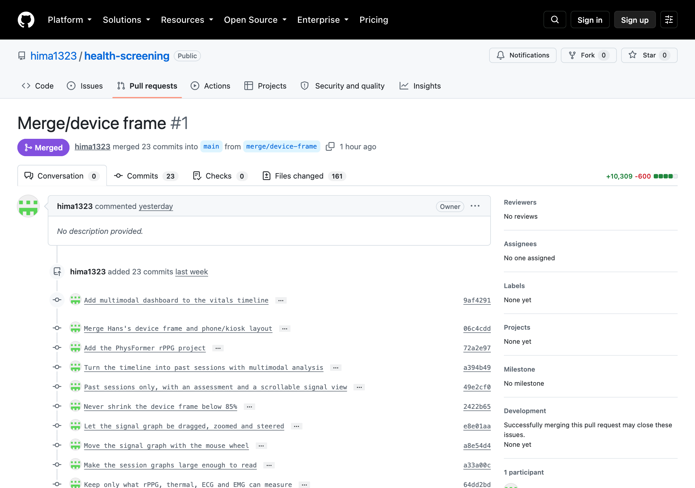
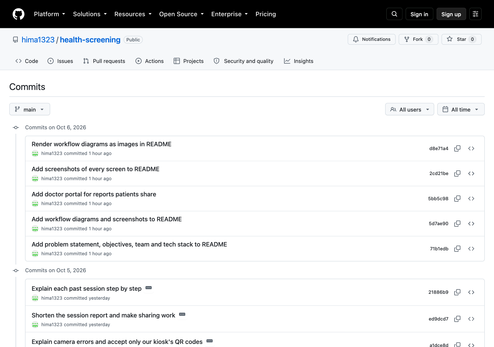

# Aura Screen — Patient App

Contactless biometric screening for patients: an introduction, an account, a
QR-triggered scan, and the report and timeline that come out of it. React +
Vite on the front, Express + Mongoose on the back — every screen reads its data
from MongoDB, nothing is hardcoded in the client.

## Links

| What | Link |
|------|------|
| Code | https://github.com/hima1323/health-screening |
| Presentation (PPT) | _add link here_ |
| Demo video | _add link here_ |
| Live site | _add link here after deployment_ |

## Project components

| Part | Folder | What it does |
|------|--------|--------------|
| Patient app | `client/`, `server/` | React app + Express/MongoDB API: QR-started scan, reports, timeline, doctor portal |
| rPPG model | `rppg1/`, `cvprlab/` | Heart rate from a face video. Trained model **CVPR Lab P4** (4.8M parameters); weights are in `rppg1/runs/*/best.pt` |
| Reasoning model | `reasoning_model/` | Expert triage system: ordered rules decide the level, a local LLM only words the explanation, a verifier checks it |
| Triage Lab | `reasoning_model/src/triage/lab_app.py` | Streamlit page to pick a ready-made sample and see input and output, benchmark a dataset, or measure heart rate from a video |

### Reasoning model in one picture

```
sensors (rPPG, thermal, devices) -> session flow (consent, scope, questions)
  -> evidence record -> rule engine (rules.yaml, first match wins)
  -> reasoning chain (cited evidence, uncertainty) -> explainer (LLM or template) -> verifier
  -> card: level, reasons, advice, contacts
```

The LLM never decides the level. Rules are data in `reasoning_model/configs/triage/*.yaml` and are marked **draft**
until a clinician signs them off, so the triage output is for demonstration and is not medical advice. Details:
`reasoning_model/TRIAGE_EXPERT_SYSTEM_STATUS.md`.

### rPPG model and weights

| Weights (`rppg1/runs/<run>/best.pt`) | Model | Note |
|------|-------|------|
| `CVPR_P4_e30_MCD` | CVPR Lab P4, 4 blocks, 30 epochs | default; MAE 1.96 (MCD) / 4.48 (UBFC) / 3.52 (MPSC) bpm |
| `CVPR_P4_d12_e30_aug_MCD`, `CVPR_P4_d12_e30_MCD` | P4, 12 blocks | best on MCD / UBFC |
| `MCD_MCD` | plain PhysFormer | baseline |
| `CVPR_phase1..4_*` | ablation ladder | phase 1 PhysFormer to phase 4 frequency |

Benchmark tables: `rppg1/runs/REPORT.md`. Datasets (MCD-rPPG, UBFC-rPPG, MPSC) are not in the repository.

## Problem statement

Routine health checks need a clinic visit, a trained operator and contact
sensors, so most people only get screened when something is already wrong.
A self-service kiosk can measure vitals without touching the patient: a camera
reads the pulse from the face (rPPG) and a thermal camera reads skin
temperature. The measurements are only useful if a patient with no medical
training can start a scan, understand the results and track them over time.
This project designs and builds that patient-facing side.

## Objectives

- Let a patient start a kiosk scan from their phone by scanning a QR code,
  with no operator present.
- Present each session's results (heart rate, temperature, ECG, EMG) in plain
  language, with a step-by-step explanation of how each value was measured.
- Show a timeline of past sessions so patients can see trends.
- Let patients share a report with their doctor.
- Apply HCI methods throughout: build (Lab 6), user testing (Lab 7), and
  improvements based on the test findings (Lab 8).

## Team members

| Name | Roll number |
|------|-------------|
| Himanshu | 2024AIB1007 |
| Hans | 2024AIB1011 |

## Technologies used

| Layer | Tools |
|-------|-------|
| Frontend | React 19, Vite, React Router, CSS Modules, lucide-react, jsQR (QR scanning) |
| Backend | Node.js, Express 5, MongoDB with Mongoose, JWT auth, Google sign-in, Multer (uploads) |
| Signal analysis | Python, NumPy; rPPG with POS/CHROM, PhysFormer and the CVPR Lab model in PyTorch (`rppg1/`, `cvprlab/`) |
| Triage reasoning | Python, YAML rule tables, Streamlit lab, local LLM (Ollama) for wording only (`reasoning_model/`) |
| Tooling | Git and GitHub, oxlint |

## Workflow

### Patient journey


### System architecture


### Starting a scan


## Screens

Captured from the running app, in the order a patient meets them.

### 1. Introduction and account

| Welcome · 1 of 3 | Welcome · 2 of 3 | Welcome · 3 of 3 | Create account |
|:-:|:-:|:-:|:-:|
|  |  |  |  |

### 2. Onboarding

| Your details + consent | Past reports (optional) | Scan Hub | How it works |
|:-:|:-:|:-:|:-:|
|  |  |  |  |

### 3. Contactless scan

| Kiosk shows a QR | Phone scans it | Active scan | ECG fallback | Capture complete |
|:-:|:-:|:-:|:-:|:-:|
|  |  |  |  |  |

### 4. Results and sharing

| Session report | Report, continued | Share with doctor |
|:-:|:-:|:-:|
|  |  |  |

### 5. Timeline and step-by-step analysis

| Past sessions | What this session shows | Steps 3–5 | Full analysis: thermal | Full analysis: signals |
|:-:|:-:|:-:|:-:|:-:|
|  |  |  |  |  |

### 6. Doctor portal


A doctor signs in separately and sees only the reports patients have shared with them, by share code.

## Version control

The project is tracked with Git and hosted on GitHub:
**https://github.com/hima1323/health-screening** (public).

### Branches

| Branch | Purpose |
|--------|---------|
| `main` | Stable code. This is what the GitHub page and the README show. |
| `reasoning-model` | Reasoning model, Triage Lab, CVPR Lab rPPG model and weights, Aura demo screens. |
| `merge/device-frame` | Working branch for the phone/kiosk device frame and later features. Merged into `main` through pull request #1. |

New work goes on a branch. It reaches `main` through a pull request, so every change to `main` can be reviewed and traced:

```bash
git switch -c feature/<name>          # start a branch
git add <files> && git commit         # one logical change per commit
git push -u origin feature/<name>     # publish it
gh pr create --base main              # open a pull request into main
```



### Commit conventions

- One logical change per commit, so any commit can be reverted on its own.
- The subject line says what the change does for the user, in the imperative
  ("Explain camera errors and accept only our kiosk's QR codes"), not which
  files changed.
- Code, docs, screenshots and the trained rPPG weights (`rppg1/runs/*/best.pt`) are committed. Secrets, build
  output and large data are not. `.gitignore` excludes `.env`, `node_modules/`, `dist/`, uploaded patient reports
  (`server/uploads/`), the rPPG datasets and caches (`rppg1/data/`), clinical data (`reasoning_model/data/`),
  screen recordings and voice notes.



### History

| Date | What changed | Commits |
|------|--------------|---------|
| 8 Sep 2026 | Initial patient app: React client, Express API, MongoDB models | `9923f1e`, `1d42a08` |
| 22 Sep 2026 | Patient accounts, onboarding and Google sign-in | `af8de42` |
| 29 Sep 2026 | Multimodal timeline dashboard, phone/kiosk device frame, PhysFormer rPPG project, past-session analysis with zoomable signal graphs, thermal frames | `9af4291` … `8efb1a1` (16 commits) |
| 30 Sep 2026 | Fewer sample reports, dates on session cards | `0b00956` |
| 5 Oct 2026 | Clearer camera errors, only the kiosk's own QR codes accepted, shorter session report with working sharing, step-by-step explanation of each past session | `a1dce8d`, `ed9dcd7`, `21886b9` |
| 6 Oct 2026 | Doctor portal for shared reports; README with problem statement, objectives, workflow diagrams and screenshots | `5bb5c98`, `71b1edb` … `d8e71a4` |

Run `git log --oneline` for the full list.

### Getting the code

```bash
git clone https://github.com/hima1323/health-screening.git
cd health-screening
```

Then follow [Run it](#run-it) below.

## Structure

```
health-screening/
├── client/                 Vite React app (patient screens, kiosk, demo scan, doctor portal)
├── server/                 Express + Mongoose API (auth, screening data, live scans, doctor, /api/triage proxy)
├── model_service/          the reasoning model as an HTTP service (Python), its fold models and samples
├── rppg1/                  rPPG training, benchmark and live dashboard
│   ├── model/              PhysFormer
│   ├── bench/              preprocessing, training harness, infer.py (Predictor), benchmark
│   ├── webapp/             live webcam dashboard (Streamlit)
│   └── runs/               trained weights best.pt + REPORT.md
├── cvprlab/                CVPR Lab model (the one used: phase4_frequency)
├── reasoning_model/        expert triage system
│   ├── configs/triage/     rules, ranges, red flags, questionnaire, contacts (YAML)
│   ├── src/triage/         rules_engine, reasoning_chain, explainer, verify, session,
│   │                       lab_app (Triage Lab), kiosk_app, demo_service, bench/, derive/, measure/
│   ├── vignettes/ templates/ evidence/   sample cases and clinician templates
│   └── tests/              244 tests
├── docs/                   diagrams, screenshots
└── render.yaml             Render deployment
```

## Setup and steps to execute

Tested on Windows 11 with Python 3.13/3.14 and Node 24. Everything below runs from a fresh clone.

### A. Triage Lab (reasoning model and rPPG model) - no database needed

```bash
git clone https://github.com/hima1323/health-screening.git
cd health-screening/reasoning_model
python -m venv .venv
.venv\Scripts\activate                 # macOS/Linux: source .venv/bin/activate
pip install -r requirements-lab.txt
python -m pytest -q                     # expect: 244 passed
streamlit run src/triage/lab_app.py     # opens http://localhost:8501
```

1. Tab **0 - Try a sample**: choose "Draft vignettes" (or "Template sample"), pick a case. Section 1 shows the input,
   section 2 the triage level, the reason and the advice. Open "Show full detail" for the reasoning chain.
2. Tab **1 - Benchmark a dataset**: choose "Template sample", press **Run the benchmark** (metrics vs the baselines).
3. Tab **3 - Face video**: upload a 30-60 s face video, pick model `p4` and press **Measure heart rate**. It uses the
   committed weights `rppg1/runs/CVPR_P4_e30_MCD/best.pt`. Picking a dataset sample there needs the datasets
   (`rppg1/data/cache`), which are not in the repository.
4. The Yale and MIMIC-IV-ED sets in tabs 0 and 1 need their data downloaded into `reasoning_model/data/public`; the
   vignettes and the template work without it.

The explanation text uses fixed templates by default. To use the local LLM, install Ollama, run
`ollama pull qwen2.5:3b-instruct`, and switch on "Write the explanation with the local LLM".

### B. Patient app

```bash
cd server && npm install && cp .env.example .env     # set MONGODB_URI (local MongoDB or Atlas)
npm run seed && npm start                             # API on http://localhost:4000
cd ../client && npm install && npm run dev            # http://localhost:5173
```

### C. Patient app with the triage demo (QR -> sample -> result)

Start the reasoning service, then the app: `cd reasoning_model/src && python -m triage.demo_service` (port 5055), and
run section B with `DEMO_WITHOUT_DB=1` if no database is available. Open `/kiosk?demo=1` on the laptop and `/demo` on a
phone. `start_aura_demo.bat` does all of this on Windows.

## Run it (patient app, detail)

Needs MongoDB on `mongodb://127.0.0.1:27017`, or set `MONGODB_URI`.

```bash
# 1. configure and seed (once)
cd server && npm install && cp .env.example .env && npm run seed

# 2. API
npm start                       # http://localhost:4000

# 3. client, in a second terminal
cd ../client && npm install && npm run dev    # http://localhost:5173
```

After changing the analysis, rebuild the study sessions and reload just those —
`npm run sessions` leaves user accounts alone, so nobody gets signed out.
`npm run seed` also resets the demo patient, and keeps accounts too.

```bash
python3 analysis/build_sessions.py && (cd server && npm run sessions)
```

## Live scan and the reasoning model

A scan runs end to end on real requests:

1. The kiosk (`/kiosk`) shows a QR code the server signed; it changes every 10 minutes.
2. The phone scans it (**Begin contactless scan**); the server checks the signature and starts a scan
   (`POST /api/scans`). The kiosk screen follows along (`GET /api/stations/:id/live`).
3. The station "captures". This demo station has no sensors, so it replays a recorded sample: one
   2-minute n-back block from ADABase, as 30 s feature windows of 8 sensors (`model_service/samples/`).
4. The server sends that sample to the model service (`model_service/serve.py`, Python): 8 LightGBM sensor
   agents + the fusion model from `reasoning_model/`, using the fold that was trained on the other 29 people,
   so it never saw the person it reads. It returns the call, confidence, each sensor's exact log-odds push,
   each window, the strongest features (TreeSHAP) and a template explanation.
5. The answer becomes a report with its own share code. The patient sees it in plain words; a doctor who
   enters the code sees the full analysis, and it lists under **Model results**.

The server starts the model service itself (Python from `reasoning_model/.venv`, else `python3`, or
`MODEL_PYTHON`). `python model_service/serve.py --check` confirms it reproduces `fusion.py`'s own
probabilities; `model_service/export_samples.py` rebuilds the samples and copies their fold models.

### Presentation run-through

1. Laptop / projector: open `https://<app>/kiosk` — the QR code.
2. Phone (app or browser): create an account, fill in details, **Begin contactless scan**, point at the QR.
   If the camera won't start, **Continue without camera** links to the same station.
3. Watch both screens: capture countdown → sample sent → model answers (about 15 s). **View session report**.
4. On the report, **Share with doctor** shows the code.
5. Doctor: `/doctor/login` (or **I'm a doctor** on the sign-in screen) → **Add shared report** → the code.
   The report shows the model output; **Model results** lists every scan and how often the call matched what
   the person was really doing. Add a note on the patient page. The dashboard refreshes every 10 s.

Scans rotate through the samples (3-back high, 1-back low, 3-back dual high), so a second scan shows a
different result.

## Deploy (Render)

`render.yaml` defines one free Docker web service (`Dockerfile`): the built client, the Express API and the
Python model service and the triage reasoning service, all on one HTTPS URL. The image build runs the model self-check, so a broken model
fails the deploy instead of the demo.

1. Render dashboard → **New → Blueprint** → pick this repo and branch.
2. Fill in `MONGODB_URI` (MongoDB Atlas; allow `0.0.0.0/0` in Network Access),
   `GOOGLE_CLIENT_ID` and `DEMO_DOCTOR_EMAIL`. `JWT_SECRET` is generated.
3. Load the demo data into Atlas once, from this machine:
   `cd server && MONGODB_URI='<atlas uri>' npm run seed`
4. For Google sign-in, add the `https://<name>.onrender.com` URL to the OAuth
   client's Authorised JavaScript origins.

The server pings its own `/api/health` every 5 minutes (when `RENDER_EXTERNAL_URL`
is set, which Render does) so the free instance doesn't sleep. `/api/health` also reports whether the model
service is up (`"model": true`) — check it before presenting.

The site works in any phone or laptop browser at the onrender.com URL.
Uploaded past reports live on the instance's disk and are lost on each redeploy.

The triage demo runs on the hosted site too: open `/kiosk?demo=1` on a laptop and scan its code from `/demo` on a
phone. The image builds its demo cases with `python -m triage.demo_samples --build`; without the MIMIC/Yale/rPPG
data in the image that gives the draft vignette cases only, and explanations use the fixed templates (no Ollama).

## Environment

`server/.env` — see `server/.env.example`.

| Variable | Needed for |
| --- | --- |
| `MONGODB_URI` | anything other than a local MongoDB |
| `JWT_SECRET` | signing sessions — set a long random string outside development |
| `GOOGLE_CLIENT_ID` | the Google sign-in button; the app falls back to email + password without it |
| `PORT` | moving the API off 4000 |

For Google sign-in, add `http://localhost:5173` to the OAuth client's
**Authorised JavaScript origins** in Google Cloud Console. No client secret is
needed — the browser gets the ID token and the server only verifies it.

## API

| Method | Path | Purpose |
| --- | --- | --- |
| `POST` | `/api/auth/register` · `/api/auth/login` | email + password accounts |
| `POST` | `/api/auth/google` | exchange a Google ID token for a session |
| `GET` | `/api/auth/me` | restore a remembered session |
| `PUT` | `/api/auth/me/profile` | onboarding details |
| `POST`/`DELETE` | `/api/auth/me/reports[/:id]` | attach or drop past reports |
| `GET` | `/api/primary` | resolve the signed-in patient and session ids |
| `GET` | `/api/patients/:id/scan-hub` · `/timeline` | screen data |
| `GET` | `/api/sessions/:sessionId/report` | screen data |
| `POST` | `/api/scans` | start a live scan from a kiosk code → `GET /api/scans/:id` to follow it |
| `GET` | `/api/stations/:id/live` | the kiosk's view of its current scan (stage only) |
| `GET`/`POST`/`DELETE` | `/api/doctor/patients/:id/notes` · `/api/doctor/notes/:id` | a doctor's own notes |
